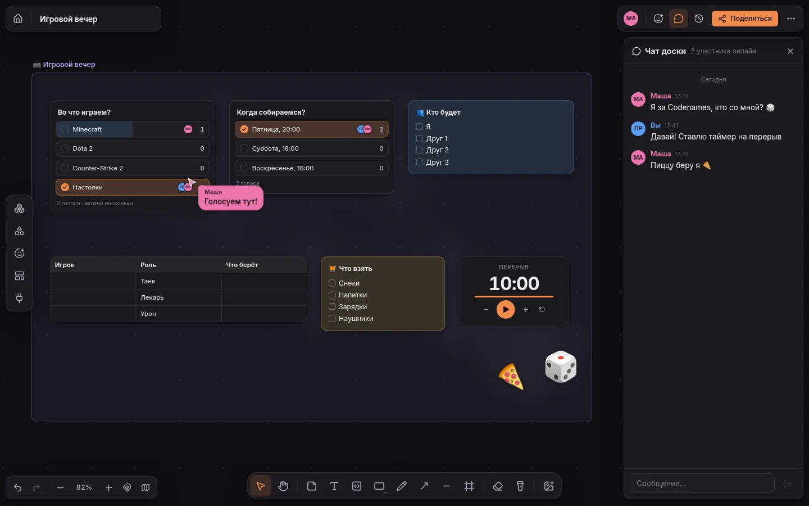
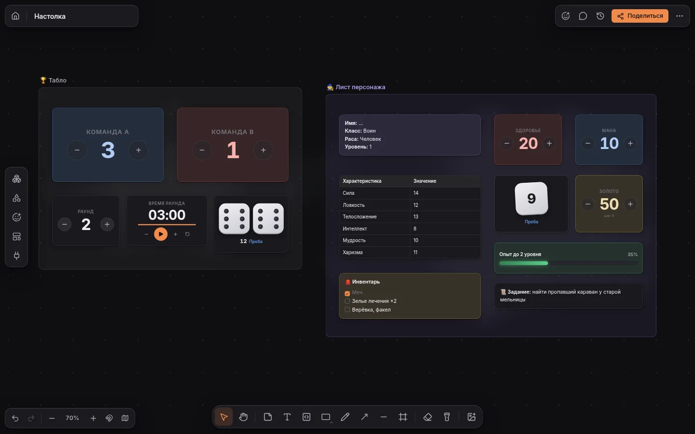
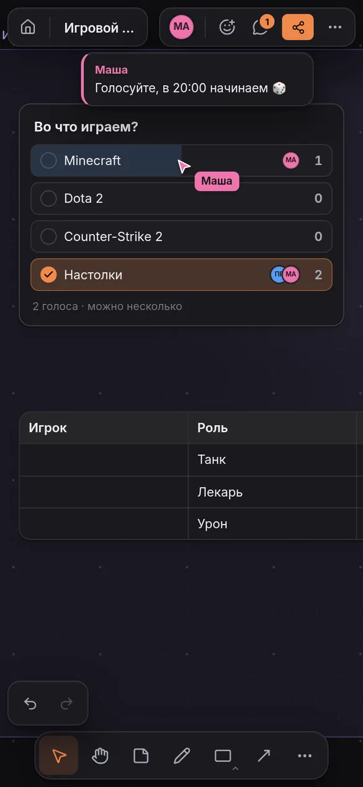

# SPACE

Бесконечная доска для себя, друзей и команды: заметки, код, файлы, ссылки с живым превью,
фигуры и стрелки, таблицы, голосования, таймеры, счётчики и кубики — и всё это вместе,
в реальном времени, с чатом и сообщениями прямо у курсора.



<p>
  
  
</p>

## Что нового в 1.1

- **Логика на стрелках.** Соедините два объекта стрелкой, нажмите ⚡ — и выберите «когда» и
  «что сделать»: флажок поднимает шкалу прогресса, переключатель показывает лампочку, кнопка
  бросает кубики, кубики прибавляют очки к счётчику, полная шкала запускает салют. Правила видны
  прямо на стрелке и «пробегают» по ней искрой, когда срабатывают.
- **13 новых объектов:** кнопка, переключатель, ползунок, оценка звёздами, часы с часовыми поясами,
  обратный отсчёт, живая диаграмма, QR-код, колесо фортуны, статус, трекер привычек, вычисление
  (сумма, среднее, минимум, максимум…) и логический блок «И / ИЛИ / НЕ / ровно один». Шесть
  новых шаблонов в группе «Интерактив и логика».
- **Панель «Оформление»** для любого объекта: готовые наборы, заливка и градиент, цвет текста,
  обводка (цвет, толщина, пунктир), скругление, тень и свечение, прозрачность, анимация, отражение,
  фильтры, метка-тег и «спрятать от зрителей». Оформление можно скопировать на другие объекты
  (`Ctrl+Alt+C` / `Ctrl+Alt+V`).
- **Новая палитра цвета** вместо системной: квадрат насыщенности, полоса оттенка, `#hex`,
  пипетка и недавние цвета — одинаково работает в любом браузере и на телефоне.
- **Права и приглашения.** Роли на доске: владелец, хост, редактор, комментатор, зритель;
  ссылки-приглашения с ролью, числом входов и сроком; блокировка участников; заморозка доски,
  доступ к чату, истории и копированию. На сервере — ранги (гость, участник, особый,
  администратор, владелец) с лимитами досок, файлов и участников, приглашения на сервер и
  панель «Сервер» в настройках.
- **Телефон.** Чат открывается листом поверх панели инструментов и не прячется под клавиатурой,
  панель объекта — внизу экрана, крупные ручки и пункты меню, касание двумя пальцами — отменить,
  тремя — повторить, долгое касание — рамка выделения, режим «выбирать несколько».
- **Быстрее с картинками и GIF.** Оригинал картинки грузится, только когда она действительно
  крупно на экране и камера остановилась; GIF двигаются только вблизи; на дальнем плане
  картинки рисуются из уменьшенных копий, а новые объекты — настоящими мини-версиями.

## Что умеет

**Объекты.** Заметки с Markdown, флажками задач и `$формулами$`, текст, код, картинки, видео,
аудио, файлы и «полки» с файлами, ссылки, фигуры (22 вида: блок-схемы, звёзды, сердца, облака…),
стрелки и линии, рамки-разделы, таблицы, карточки задач (исполнитель, срок, приоритет),
голосования, таймеры, **счётчики, кубики (d4–d100), шкалы прогресса**, эмодзи-стикеры,
**комментарии-булавки** с обсуждением, а ещё кнопки, переключатели, ползунки, оценки, часы,
обратный отсчёт, диаграммы, QR-коды, колесо фортуны, статусы, трекеры, вычисления и логические
блоки. Всё — в панели «Библиотека» слева (`B`): щелчок или перетаскивание, поиск по-русски.

**Логика.** Стрелка между объектами может быть правилом: «когда источник …» → «сделать с
целью …». Источники — флажки и задачи, переключатели, кнопки, счётчики, ползунки, прогресс,
оценки, кубики, колесо, статусы, трекеры, таймеры, заметки со списками. Действия — прибавить,
отнять, установить, показывать долю выполненного, считать выполненные, отметить, включить,
повторять за источником, бросить кубики, крутить колесо, запустить таймер, сменить статус,
показать или спрятать, перекрасить, показать на экране, написать в чат, эффект (салют, сердечки,
звёзды, звонок). Несколько стрелок в один объект складываются: шкала прогресса показывает долю
выполненных флажков, «Вычисление» — сумму входов, «Логический блок» включается, когда готовы
все (или любой) источники. Правило срабатывает у того, кто сделал действие, и приходит всем
обычной правкой — без двойных срабатываний и с защитой от зацикливания. Пример — шаблон
«Как работает логика».

**Шаблоны — 30 штук** в пяти группах: игры (игровой вечер, тактическая карта, турнирная
сетка, табло, лист персонажа, тир-лист, диздок), команда (встреча, мозговой штурм, ретро,
спринт с покером планирования, канбан), планы (дорожная карта, OKR, неделя, Lean Canvas, SWOT,
Эйзенхауэр, за и против), схемы (майнд-карта, блок-схема, оргструктура, путь пользователя,
мудборд), интерактив и логика (трекер привычек, квест с наградой, викторина, ежедневный созвон,
«решаем вместе», «как работает логика»). Доску можно сразу начать с шаблона на главной.

**Стрелки и схемы.** Подведите мышь к краю выбранного объекта — появится «+», который едет за
указателем: щелчок — связанная карточка рядом, перетаскивание — стрелка ровно из этой точки,
отпустили в пустоте — выберите, что создать. Стрелки цепляются к сторонам и тянутся за
объектами; прямые, плавные или под прямым углом, 10 наконечников трёх размеров, подписи,
пунктир. `Tab` / `Shift+Tab` / `Alt+стрелка` — связанная карточка справа, снизу или в любую
сторону (быстрые схемы и майнд-карты). Умное рисование превращает штрих в ровную фигуру.
Направляющие выравнивания — по желанию (`Shift+S`).

**Код.** Подсветка для 70+ языков (от Python и Rust до GDScript, GLSL, Verilog и COBOL), язык
определяется по имени файла. **JavaScript запускается прямо на доске** (`Shift+Enter`) в
изолированном потоке с выводом console и ограничением по времени; HTML, Markdown, SVG и LaTeX
переключаются в предпросмотр.

**Ссылки и сервисы.** Карточки с превью для любых сайтов (Open Graph, JSON-LD, oEmbed), а для
популярных — данные из их API: звёзды и язык репозитория GitHub, статус issue и PR, версия
npm-пакета, цена и жанры игры в Steam, краткое содержание статьи Википедии. Прямо в карточке
открываются видео YouTube, VK Видео, Rutube, Vimeo, Twitch и Loom, музыка Spotify и SoundCloud,
макеты Figma и Miro, Google Документы, Таблицы и Презентации, CodePen и посты X. Видео и музыка
не останавливаются, когда вы уходите к другим объектам.

**Вместе.** Курсоры и выделения участников, «следовать за» человеком, указка (`K`).
**Чат доски** (`M`) — к сообщению можно приложить выделенные объекты, **сообщение у курсора**
(`/`), летящие **реакции**, кнопка «**Позвать всех**» к себе, комментарии к объектам. Голоса, счётчики и броски кубиков
общие и честные: одновременные нажатия не теряются. Доступ по ссылке: только участники /
просмотр / комментарии / правка; роли владелец, хост, редактор, комментатор, зритель;
ссылки-приглашения с ролью, сроком и числом входов (подробнее — ниже).

**Под себя.** Тёмный интерфейс с восемью акцентами, восемь фонов доски (графит, полночь, океан,
лес, слива…; их видят все), сетка точками, линиями или крестиками. У объектов — 10 цветов палитры и
**любой свой цвет**, прозрачность, шрифты (обычный, с засечками, моноширинный, рукописный),
размеры, заливки и обводки, а в панели «Оформление» (кисть над объектом) — готовые наборы,
градиенты, цвет текста, толщина и пунктир обводки, скругление, тени и свечение, анимации,
отражение, фильтры и теги. У новых объектов свои настройки в «Настроить»: подписи, пределы и шаг,
варианты колеса, часовой пояс, вид диаграммы и многое другое. В настройках — прилипание, свечение под группами, мини-карта, имена
у курсоров, чужие выделения, поведение колеса мыши, «меньше анимации».

**Надёжно и быстро.** История версий (снимки сами и вручную, восстановление всей доски или только
выделенного), работа без сети с автоматическим слиянием, тысячи объектов без рывков (дальний план
рисуется на canvas, картинки — из уменьшенных копий), палитра команд `Ctrl+K`, поиск `Ctrl+F`.

**С телефона.** Один палец двигает доску или объект, щипок — масштаб, долгое касание на пустом
месте — рамка выделения (или меню, если просто отпустить), касание двумя пальцами — отменить,
тремя — повторить. Панель объекта — внизу экрана, кнопка «Выбирать несколько» — выделение
касаниями, чат и «Оформление» — листом снизу.

## Запуск на Linux

Нужен **Node.js 24 LTS** (подойдёт и 22.18+): из пакетов дистрибутива, [nodejs.org](https://nodejs.org/),
nvm, fnm, volta, mise или asdf. Ничего собирать не нужно — база данных встроена в Node.

```bash
unzip space-1.1.0.zip && cd space
./start.sh
```

`start.sh` сам найдёт Node (в том числе из менеджеров версий), в первый раз поставит зависимости
и соберёт клиент, после обновления — тоже. Откройте **http://localhost:8787**. Остановить — `Ctrl+C`.

**Работать в фоне и запускаться при входе** — служба пользователя systemd, без root:

```bash
npm run service          # установить и запустить; появится и ярлык SPACE в меню приложений
systemctl --user status space
journalctl --user -u space -f
npm run service:remove   # убрать
```

Чтобы SPACE работал и без входа в систему (после перезагрузки, для доступа с других устройств):
`loginctl enable-linger`. Если включён брандмауэр: `sudo ufw allow 8787/tcp` (или
`sudo firewall-cmd --add-port=8787/tcp --permanent && sudo firewall-cmd --reload`).

**Docker:** `docker compose up -d` — данные в томе `space-data`.

macOS — так же через `./start.sh`.

## Запуск на Windows

1. Установите **Node.js 24 LTS** (или 22.18+) с [nodejs.org](https://nodejs.org/).
2. Распакуйте архив и дважды щёлкните **`start.cmd`** — он поставит зависимости (в первый раз),
   соберёт клиент и запустит сервер.
3. Откройте **http://localhost:8787**.

## Данные и настройки

Данные лежат в папке `storage/` (база `space.db`, файлы, превью). Резервная копия — скопировать
эту папку при остановленном сервере. Отдельную доску можно скачать файлом (меню доски →
«Скачать файл доски») и загрузить обратно на главной.

Настройки — в файле `.env` (образец — `.env.example`): порт и адрес, папка данных (`~/` — от
домашней папки), лимит загрузки, код приглашения, `GITHUB_TOKEN` (больше запросов к API GitHub
для карточек и приватные репозитории), превью ссылок локальной сети, работа за прокси.

## Права, ранги и приглашения

**На доске** (кнопка «Поделиться»):

| Роль | Что может |
| --- | --- |
| Владелец | всё, в том числе удалить доску или передать её другому |
| Хост | как владелец, кроме удаления и передачи: участники, приглашения, настройки доски |
| Редактор | менять доску |
| Комментатор | смотреть, писать в чат, оставлять комментарии |
| Зритель | смотреть и пользоваться указкой |

- **Ссылка** — общий доступ: закрыто (только участники), просмотр, комментарии или правка.
- **Приглашения** — отдельные ссылки с ролью, подписью, числом входов и сроком; их можно
  отозвать. Кто может приглашать (все, редакторы или только хосты), решает хост.
- **Участники** — сменить роль, убрать с доски, заблокировать (заблокированный не войдёт даже по
  ссылке).
- **Настройки доски** — заморозить (править могут только хосты), кто пишет в чат, кто
  восстанавливает версии, можно ли всем скачивать и копировать доску, предел участников.

**На сервере** (Настройки → «Сервер»: каждый видит там свой ранг, лимиты и занятое место,
администраторы — ещё и управление). Самый первый аккаунт — владелец сервера. Ранги: гость, участник, особый, администратор, владелец. У каждого ранга свои лимиты:
сколько своих досок, размер одного файла и место под все файлы, сколько участников на своей
доске, можно ли создавать доски, загружать файлы и выдавать приглашения. Регистрация —
открытая, по приглашению или закрыта; новичкам — выбранный ранг. Приглашения на сервер дают
заданный ранг, с числом входов и сроком. В списке людей — поиск, смена ранга, блокировка, выход
из всех сеансов и передача владения сервером. Приглашение на доску пускает человека на сервер
гостем, даже если регистрация по приглашениям.

Код из `SPACE_INVITE_CODE` по-прежнему работает: если он задан, регистрация по умолчанию — по
приглашению, а код даёт ранг «участник».

## Обновление

Остановите сервер, распакуйте новый архив поверх старой папки (папку `storage/` и файл `.env`
оставьте как есть) и запустите снова — `start.sh` / `start.cmd` сами поставят зависимости и
пересоберут клиент. Служба systemd запускает сервер напрямую, поэтому перед её перезапуском
соберите клиент сами:

```bash
systemctl --user stop space        # или sudo systemctl stop space для системной службы
# распаковать архив в папку SPACE, не трогая storage/ и .env
npm ci && npm run build
systemctl --user start space       # или sudo systemctl start space
```

База обновляется сама при запуске: новые таблицы и столбцы добавляются, данные не теряются.

## С телефона через Tailscale

1. Поставьте [Tailscale](https://tailscale.com/download) на компьютер и телефон, войдите в один аккаунт.
2. Запустите SPACE на компьютере — в консоли появятся адреса, среди них
   `http://100.x.y.z:8787` — это адрес в сети Tailscale. Откройте его на телефоне
   (или `http://имя-компьютера:8787`, если включён MagicDNS).
3. Если не открывается — разрешите входящие подключения (Linux — см. выше, Windows —
   PowerShell от администратора):

   ```powershell
   New-NetFirewallRule -DisplayName "SPACE 8787" -Direction Inbound -Protocol TCP -LocalPort 8787 -Action Allow
   ```

**HTTPS (рекомендуется).** `tailscale serve --bg 8787` даст адрес
`https://имя-компьютера.ваша-сеть.ts.net` с настоящим сертификатом: в защищённом
режиме браузер разрешает доступ к буферу обмена, а доску можно добавить на экран
«Домой» как приложение.

**Войти тем же аккаунтом на телефоне:** Настройки → «Войти на телефоне или другом
компьютере» → отсканируйте QR-код (действует 10 минут). Или задайте там же логин и
пароль. Чтобы позвать других — кнопка «Поделиться»: ссылка и QR-код.

## Railway

1. Создайте сервис из репозитория или папки (`railway up`) — сборка идёт по `Dockerfile`
   (настроено в `railway.json`).
2. **Добавьте том (Volume)** с точкой монтирования `/data` — иначе доски пропадут при
   передеплое.
3. Переменные: `TRUST_PROXY=1` и `SPACE_INVITE_CODE=ваш-код` (без кода любой, кто знает
   адрес, сможет завести аккаунт). `PORT` Railway задаёт сам.
4. Settings → Networking → Generate Domain.

Нужна одна копия сервиса (одна реплика): доски, открытые для совместной работы,
живут в памяти процесса.

## Разработка

```bash
npm run dev      # Vite (http://localhost:5173) + сервер с перезапуском при правках
npm run check    # проверка типов (svelte-check)
npm test         # модульные тесты (Vitest)
npm run build && npm run e2e   # сценарии в настоящем браузере (Playwright)
```

Для `npm run e2e` нужен Chromium: подойдёт системный (`chromium`, `google-chrome`) или
`npx playwright install chromium`. Нагрузочный замер: `node tests/e2e/seed.ts perf 5000 > perf.space`,
затем `node tests/e2e/perf.ts http://localhost:8787 perf.space`.

Устройство проекта и принятые решения — в [docs/ARCHITECTURE.md](docs/ARCHITECTURE.md).

## Горячие клавиши

| | |
| --- | --- |
| `V` выделение, `H` рука (или зажать пробел) | `N` заметка, `T` текст, `C` код |
| `R` прямоугольник, `O` эллипс | `D` рисование, `P` перо, `E` ластик, `K` указка |
| `A` стрелка, `L` линия, `F` рамка | двойной щелчок по инструменту — закрепить |
| `B` библиотека, `M` чат, `/` сообщение у курсора | `Shift+Enter` запустить код |
| `Ctrl+K` команды, `Ctrl+F` поиск | `Shift+1` показать всё, `Shift+2` — выделенное |
| `Ctrl+Z` / `Ctrl+Shift+Z` отменить / повторить | `Ctrl+D` дублировать, `Alt`+перетаскивание — копия |
| `Ctrl+G` обернуть в рамку, `G` разложить сеткой | `Ctrl+L` закрепить, `Ctrl+]` / `Ctrl+[` выше / ниже |
| `Shift+S` направляющие, `Enter` — править / бросить кубик | колесо мыши — масштаб, тачпад — прокрутка (настраивается) |
| `Ctrl+Alt+C` / `Ctrl+Alt+V` взять / применить оформление | `?` — все клавиши |
